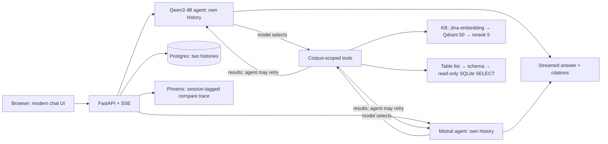

# SLM vs Mistral RAG Lab

> **POC status · 2 November 2026:** 20 World Bank GEP files indexed hain (1,280 Qdrant points). Model-directed action selection, per-answer Thinking trace aur model-named Phoenix spans implemented hain; 50 backend tests pass. Greeting ke liye direct action hai; live SQL agent ne India/South Asia 2027 average **7.05% [1]** diya. Current Mistral Large request account tier ki wajah se 403 de rahi hai; end-to-end hosted verification access enable hone par complete hogi. Full gold-set benchmark pending hai.

[Architecture aur diagrams](docs/ARCHITECTURE.md) · [Backend project](backend/README.md) · [Corpus manifest](data/gep_2026_june/README.md) · [Evaluation guide](eval/README.md)

## Kya karta hai?

Ek question do **independent agents** ko jata hai. Har agent ka LLM pehle apni chat history aur question padhta hai, phir decide karta hai ki direct answer dena hai, KB search karni hai, ya spreadsheet inspect karke read-only SQL chalani hai. KB tool top 50 chunks retrieve karke Jina se top 5 rerank karta hai. Insufficient evidence par model revised query ke saath dobara tool call kar sakta hai. Factual answers `[1]`, `[2]` citations dete hain; evidence confidence heuristic hai, correctness probability nahi. Greetings par retrieval aur evidence percentage apply nahi hote.



UI chat-only hai: left side saved sessions, center mein do model panels. **New chat** sirf empty draft kholta hai; pehla message send hone par session banta hai aur ID `/chat/{id}` URL mein aata hai. Blank drafts history mein nahi dikhte. Har saved chat ke delete button par confirmation popup aata hai. Page fixed viewport mein rehta hai; sidebar aur answer panels apne andar scroll karte hain. Har response ke andar expandable **Thinking trace** actual model decisions, tool inputs/results aur retrieval stages live dikhati hai; separate workflow panel nahi hai. Trace reload par bhi saved run se milti hai. Private model reasoning display nahi hoti.

## Technology choices

| Concern | POC choice |
| --- | --- |
| UI | Static HTML/CSS/JavaScript in lightweight nginx container; no Node build or Gradio runtime |
| API + local retrieval model service | Single `uv` Python project in [`backend/`](backend/); separate Compose containers |
| Chat + metadata + LLM cache | PostgreSQL; branch histories are isolated; exact prompt cache skips repeat generation |
| Vector storage | Qdrant, 1024-dimensional cosine vectors |
| Embedding | Hosted `jina-embeddings-v5-text-small` with `retrieval.query` / `retrieval.passage` tasks |
| Rerank | Hosted `jina-reranker-v3.5`; Cohere trial reranker fallback on Jina HTTP failure |
| Generation | Local Hugging Face Qwen3 4B GGUF through llama.cpp; hosted Mistral Large 4 |
| Observability | Local Phoenix `slm-rag-model-runs` project; only model-run traces |
| Folder indexing | One-shot Compose `ingest` job |

**Model action choose karta hai:** first call par `tool_choice=required` se LLM `search_knowledge_base`, `list_tables`, `inspect_table`, `query_table_sql`, ya non-data greeting/capability/clarification ke liye `respond_directly` select karta hai. Backend keyword routing nahi karta. Source tools ke results ke baad model answer ya further tools select kar sakta hai. Natural language se model schema dekhkar SQL banata hai; query sirf selected CSV/Excel ke temporary in-memory `data` table par read-only chalti hai. Chat/application database expose nahi hota. Har turn maximum 6 model steps aur 8 source-tool calls rakhta hai. Missing/invalid citations par ek model revision request ho sakti hai. Follow-up resolution same branch ke recent messages se LLM karta hai. Details [architecture document](docs/ARCHITECTURE.md) mein hain.

Existing local Qwen embedding corpus (`gep-2026-06-v1`) preserve kiya hai. New Jina vectors alag corpus (`gep-2026-06-jina-v5`) mein hain; same dimension hone ke bawajood two model vector spaces mix nahi kiye. Old sessions apne original corpus se continue kar sakte hain. Hosted retrieval key trial balance/rate limits par depend karti hai; Jina 429 par indexing job `Retry-After` follow karke retry karti hai. Provider comparison aur sources [architecture document](docs/ARCHITECTURE.md) mein hain.

## Run locally

Demo machine: MacBook Air M5, 10 CPU cores, 24 GB unified memory. Docker Desktop ko ~16 GB allocation se start karein; local SLM + old retrieval service dono memory use karte hain.

```bash
uv sync --project backend
cp .env.example .env
# .env mein MISTRAL_API_KEY, JINA_API_KEY, COHERE_TRIAL_KEY set karein.
bash scripts/fetch_slm.sh
docker compose up -d --build
docker compose build ingest
docker compose run --rm ingest --path /kb/gep_2026_june --corpus gep-2026-06-jina-v5
curl http://127.0.0.1:8000/v1/corpora/gep-2026-06-jina-v5
```

`data/gep_2026_june/` mein demo files already hain. Fresh download chahiye to ingestion se pehle `bash scripts/fetch_gep_data.sh` run karein. Job folder ko recursively scan karke PDF, TXT, Markdown, CSV, XLSX aur DOCX index karta hai; ZIP aur unsupported files skip hote hain. Same files aur same corpus ID ke saath job dobara chalane par ready documents skip honge. Kisi indexed file ka content badle to naya corpus ID use karein aur backend ka `DEFAULT_CORPUS` bhi usi ID par set karein. Jina embedding requests API quota consume karti hain; large folders ko index hone mein time lag sakta hai.

- **Chat UI:** http://127.0.0.1:7860
- **FastAPI docs:** http://127.0.0.1:8000/docs
- **Phoenix traces:** http://127.0.0.1:6006/projects — project `slm-rag-model-runs`; local instance mein email/password nahi chahiye.

`POST /v1/uploads` programmatic ingestion ke liye available hai, UI mein upload control nahi hai. `.env` badalne par `docker compose up -d --no-deps --force-recreate backend` chalayein. Keys ko chat ya version control mein paste na karein.

Hosted model `MISTRAL_MODEL` se configure hota hai (default `mistral-large-4`). Current free key par Large request ne `403: model not available in your subscription tier` diya; model list mein Large/Medium nahi mile. Large access enable karna hoga, ya explicitly allowed model select karna hoga. App silently smaller model par switch nahi karti; trace aur answer mein actual configured model name rehta hai.

## Example

User: **“What is the South Asia GDP growth forecast in 2026?”**

- Local SLM: **6.3%** with `[2]`/`[3]` source citation.
- Mistral Large 4: **6.3%** with source citations.
- Workflow: LLM chooses tools → KB search/rerank or table inspection/SQL → LLM checks results, may retry → cited streamed answer → citation check.

Follow-up **“And what about 2027?”** par both branches ne apni separate previous messages se South Asia resolve karke **6.9%** answer diya. Sources and confidence under each answer dikhte hain. Confidence score source relevance, citation coverage aur numeric consistency se banta hai, aur 0.9 par capped hai.

## Checks

```bash
uv run --project backend pytest -q backend/tests
uv run --project backend ruff check backend/src backend/tests scripts
node --check frontend/app.js
```

Earlier smoke test mein 20 ready documents aur 1,280 Qdrant points Jina corpus mein mile the; live two-model question aur follow-up ne cited 6.3%/6.9% answers diye the. Fresh Docker volumes par ingestion dobara karna hoga. SLM generation ~25 s; hosted Mistral response ~6 s on the initial question, with retrieval/rerank ~2–3 s per branch. Ye two-turn smoke timings hain, benchmark percentiles nahi. Gold questions [eval/gold.jsonl](eval/gold.jsonl) mein hain; [evaluation runner](scripts/run_eval.py) available hai. Full comparative report ke liye gold set execute aur source-support manually review karna hoga.
