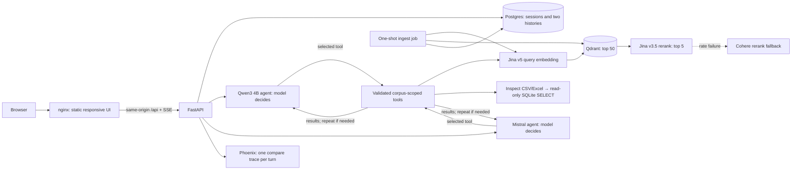

# SLM vs Mistral RAG POC — architecture

> **Updated 2 November 2026.** World Bank GEP June 2026 corpus: 20 ready files and 1,280 Jina vectors. Model-directed agents, SQL tools, Thinking trace persistence and model-named/session-tagged Phoenix spans implemented; 50 backend tests pass. SQL average **7.05% [1]** verified live. Current Mistral Large call returns account-tier 403, so latest hosted live verification awaits access. Full gold-set comparison remains to be run.

[Setup](../README.md) · [Backend structure](../backend/README.md) · [Corpus manifest](../data/gep_2026_june/README.md) · [Evaluation](../eval/README.md)

## 1. Goal aur example

User ek question poochta hai; FastAPI same text ko SLM aur Mistral branch mein append karta hai. Dono agents **apni-apni history** model ko dete hain. Har LLM pehle decide karta hai: direct reply, KB search, table inspection ya SQL. Tool result ke baad model answer de sakta hai ya revised query/tool call kar sakta hai. Factual answers sources, latency aur heuristic evidence-confidence dete hain; greetings par evidence score N/A hai.

Example: “South Asia ka 2026 GDP forecast kya hai?” → dono models `6.3%` ko `[1]` jaise citation ke saath answer karte hain. Next question “Aur 2027 mein?” par har branch sirf apne previous turns se “South Asia GDP growth” samajhti hai. Same corpus shared hai; runtime retrieval results aur conversation memory shared nahi hain.

## 2. Running architecture



| Service | Why it exists |
| --- | --- |
| `frontend` | Nginx static HTML/CSS/JS, port 7860. Same-origin `/api` proxy SSE ko buffer nahi karta. No frontend build tool, Node runtime or Gradio server. |
| `backend` | FastAPI, port 8000: sessions, independent agents, streaming events, ingestion/table endpoints. Backend `uv` project and dedicated Docker image. |
| `postgres` | Durable corpus/document metadata, user and assistant turns, run status/results. |
| `qdrant` | Filtered dense search, top 50 chunks. Each corpus has its own collection. |
| `slm-server` | Hugging Face Qwen3 4B GGUF through llama.cpp, inside Docker on M5 CPU. |
| `retrieval-models` | Same backend package ka optional `models` dependency extra; older Qwen embedding corpus ko query karne ke liye local model service. New Jina corpus hosted embedding use karta hai. |
| `phoenix` | Local trace UI, port 6006. `PHOENIX_ENABLE_AUTH=false` for this same-machine POC. |
| `ingest` | On-demand job. Folder read, parsing, chunking, metadata and vector upsert; exits when done. |

No Redis in POC. Postgres source of truth hai; Qdrant searchable projection. Docker bindings localhost par hain.

## 3. Hosted retrieval choice

User-provided keys par small live probes hue: Jina v5 embedding returned 1024 dimensions, Jina v3.5 rerank returned scores, Cohere rerank returned scores, aur Mistral model ID accessible tha. Current default **Jina v5-text-small embedding + Jina v3.5 rerank** hai. Reason: hosted CPU burden kam karta hai, Jina ka embedding/rerank same account se milta hai, v5 model multilingual retrieval ke liye 1024-dimensional output deta hai, aur v3.5 Jina ka current text reranker hai. Is POC ke one-question smoke run mein retrieval/rerank ~2–3 seconds per branch tha. Isse benchmark superiority prove nahi hoti; gold-set retrieval quality compare karni hogi.

| Provider | Free/trial reality | Use in this POC |
| --- | --- | --- |
| [Jina API](https://api.jina.ai/docs), [v5 text small](https://jina.ai/en-US/models/jina-embeddings-v5-text-small/), [reranker](https://jina.ai/reranker/) | New key ko trial tokens milte hain; embedding/rerank same balance use karte hain. Rate limits and account balance apply. | Default embedding and rerank; indexing 429 par `Retry-After` ke saath retry. |
| [Cohere trial key](https://docs.cohere.com/v2/docs/rate-limits) | Trial usage limited; rerank rate cap applies. | Jina rerank HTTP failure par fallback. Embedding fallback allowed nahi, because vector space alag hai. |
| [Hugging Face Inference Providers](https://huggingface.co/docs/inference-providers/en/pricing) | Free account monthly credits $0.10 (subject to change). | Current runtime mein use nahi hota. Public Qwen weights download ke liye HF token optional hai. |

**Corpus versioning matters:** `gep-2026-06-v1` local Qwen3 embeddings se bana tha. `gep-2026-06-jina-v5` Jina v5 se dobara index hua hai; 20 documents/1,280 points ready. Dono 1024 dimensions hain, lekin vectors interchangeable nahi. `corpora.embedding_model` se retrieval per-conversation sahi provider select karta hai. Reindex new corpus ID par hua, old history preserved hai.

Model numeric questions ke liye `list_tables → inspect_table → query_table_sql` select kar sakta hai. SQL sirf selected document ke temporary `data` table par SELECT hai; chat/application Postgres database expose nahi hota. PDF/Excel/CSV/TXT files one-shot job parse karta hai; sources' page/sheet/row locators Qdrant payload aur Postgres mein rehte hain.

## 4. Streaming request sequence

```mermaid
sequenceDiagram
    participant UI as Browser UI
    participant API as FastAPI SSE
    participant DB as Postgres
    participant S as SLM worker
    participant M as Mistral worker
    participant R as Retrieval tools
    UI->>UI: New Chat = local draft, no database row
    UI->>API: First send creates conversation ID
    UI->>API: POST /v1/conversations/{id}/turns/stream
    API->>DB: Save same user question in both branches
    API-->>UI: started(session ID, turn number)
    par isolated SLM run
        API->>S: history[slm] + corpus ID
        S->>S: LLM reads own history and chooses action
        loop model-selected tools as needed, within budget
            S->>R: KB query OR table list/schema/SQL
            R-->>S: evidence/result/error
            S->>S: LLM assesses result; answer or revise query
        end
        S-->>UI: step events, then visible token deltas
        S->>DB: answer, citations, confidence, metrics
        S-->>UI: result(slm)
    and isolated Mistral run
        API->>M: history[mistral] + corpus ID
        M->>M: LLM reads own history and chooses action
        loop independent tool decisions, within budget
            M->>R: own KB query OR table list/schema/SQL
            R-->>M: evidence/result/error
            M->>M: LLM assesses result; answer or revise query
        end
        M-->>UI: step events, then visible token deltas
        M->>DB: answer, citations, confidence, metrics
        M-->>UI: result(mistral)
    end
    API-->>UI: complete
```

Har answer ke andar expandable **Thinking trace** model rounds, chosen tools, actual input/result, retrieval substages aur timing dikhati hai. Separate Live workflow panel remove hua. Events `metrics.trace` mein save hote hain, so reload par history visible rehti hai. Yeh public operational trace hai; private reasoning nahi. Native streamed tool-call arguments assemble hote hain aur validated tools execute hote hain. Visible answer tokens stream hote hain; `answer_reset` intermediate text ko clear karta hai jab model tool select kare ya citation correction maange. Mistral greedy sampling ke liye `temperature=0, top_p=1`; usage token counts stream se collect hote hain.

SSE client disconnect ho jaye to workers result Postgres mein persist karte hain. Browser reload par saved chat milti hai. Same conversation ka unfinished paired turn `409` deta hai; duplicate turns avoid hote hain. Run errors branch-specific hain: ek branch fail hone par dusri ka answer save hota hai.

## 5. Evidence, citations aur confidence

1. Model recent messages se follow-up resolve karta hai. First native call `tool_choice=required` hai: LLM source tools ya non-data `respond_directly` action select karta hai. `respond_directly.intent` greeting/capabilities/thanks/clarification enum hai. Backend keyword-based routing nahi karta. Source results ke baad `tool_choice=auto` se final answer ya further tools choose hote hain. Greeting par KB call nahi chahiye.
2. `search_knowledge_base` ke andar corpus-specific embedding → Qdrant top 50 → Jina rerank top 5 chalta hai. Cohere rerank fallback available hai. Derived notes ko primary reports ke against preference penalty milti hai.
3. Model returned evidence assess karke another standalone search query bhej sakta hai. Backend model ki satisfaction ko guarantee nahi karta; tool schema/result insufficient evidence par retry instruct karte hain.
4. `list_tables` aur `inspect_table` IDs, sheets, columns aur sample rows dete hain. `query_table_sql` model-generated SELECT ko isolated SQLite table par run karta hai. Writes, other database tables, extensions and recursive queries blocked hain; execution/row limits apply. Decimal aggregates floating point hain; display ke liye ROUND use hota hai.
5. Search/SQL results stable turn-local `[N]` citation tokens dete hain. Repeated searches chunk IDs deduplicate karti hain. History se previous citation tokens remove hote hain. Missing/invalid references par model ko ek correction request mil sakti hai; no current evidence ho to model ko appropriate tool choose karke sources fetch karne ko kaha jata hai. Remaining invalid citations publish karne ke bajay server verification-gap reply deta hai. Server IDs validate karta hai; source entailment abhi heuristic/manual evaluation hai.
6. Confidence = `0.5 × retrieval relevance + 0.3 × citation coverage + 0.2 × numeric consistency`, capped at 0.9. Direct no-tool replies ka score `null`/N/A hai; yeh fake low evidence percentage se greeting ko penalize nahi karta. Heuristic correctness probability nahi hai.

**Agent budget and isolation:** Har turn maximum 6 model rounds aur 8 tool calls rakhta hai; final budget round `tool_choice=none` se grounded answer ya gap explanation maangta hai. Tool exceptions model ko actionable result ke roop mein milte hain so it can recover. Prior tool transcripts fresh evidence ki tarah later turns par reuse nahi hote; recent user/assistant text branch-scoped hai. Context pressure par older tool excerpts shorten hote hain, citation IDs preserved rehte hain. Same tool implementations/catalog shared hain, actual tool invocations/results/history har branch ki separate hain. Tool decisions alag ho sakte hain, isliye evaluation generation ke saath routing quality bhi compare karegi.

Native function calling flow [Mistral documentation](https://docs.mistral.ai/studio/conversations/function-calling) follow karta hai. Local llama.cpp ko [function-calling support](https://github.com/ggml-org/llama.cpp/blob/master/docs/function-calling.md) ke liye `--jinja` enabled hai; alias `Qwen3-4B-Q4_K_M`, 16K context aur one active slot demo memory usage ko bound karte hain.

For example, tested query “What is the South Asia GDP growth forecast in 2026?” par Jina corpus se SLM aur Mistral dono ne **6.3%** answer diya. Both panels showed independent retrieval steps and citations. One request's ~2–3 s retrieval and ~6 s Mistral / ~25 s SLM totals are machine-specific observations, not p95 benchmarks.

## 6. Phoenix scope

Project `slm-rag-model-runs` mein **one `rag.compare` trace per paired question** hai. Children `agent.Qwen3-4B-Q4_K_M` aur `agent.<configured-Mistral-model>` hain. Har actual/cached model round ka `llm.<model-name>.call_N` span, `llm.model_name`, usage aur cache flag hai; chosen tools ke request/response child spans hain. Total LLM span count chosen path par depend karta hai, always two nahi. Har span `session.id` rakhta hai, so [Phoenix Sessions view](https://arize.com/docs/ax/observe/tracing/sessions-and-users) turns group karta hai. LLM top-level input question hai, output final text ya requested tool call; conversation/tool message attributes additional details dete hain. System prompt aur private reasoning excluded hain. FastAPI health/sidebar route tracing disabled hai. [Phoenix tracing concepts](https://arize.com/docs/phoenix/learn/tracing/how-tracing-works).

**LLM cache:** Exact messages/model/corpus/sampling + tool schemas/tool-choice ka SHA-256 key banta hai. Postgres `llm_cache` table prompt text ke bina serialized public answer/tool calls store karti hai. Model decision cached ho sakta hai; selected tools still current data par execute hote hain. `metrics.cache_hits` reused rounds count karta hai; `metrics.cache_hit=true` only if all model rounds cached. Phoenix per-call `llm.cache_hit` records reuse. Session deletion its owned cache entries bhi clear karti hai. Cache version `agent-v3` old pipeline/optional-initial-action answers reuse nahi karta.

**Current account access:** Live `mistral-large-4` request current key par 403 subscription-tier error de rahi hai; account model list mein Large/Medium IDs nahi hain. Default automatically downgrade nahi hota. Large access enable karein, ya explicitly `MISTRAL_MODEL` set karke backend recreate karein. Actual model label/trace configured name show karega.

Phoenix tool spans retrieved public text store karte hain, aur LLM span question/answer plus token counts. Private documents use karne se pehle trace redaction plus access control add karein. Postgres chat history ka source of truth hai; Phoenix ko chat database ki tarah use nahi karte.

## 7. Ingestion and commands

```bash
uv sync --project backend
cp .env.example .env
# Set MISTRAL_API_KEY, JINA_API_KEY and COHERE_TRIAL_KEY locally.
bash scripts/fetch_slm.sh
docker compose up -d --build
docker compose build ingest
docker compose run --rm ingest --path /kb/gep_2026_june --corpus gep-2026-06-jina-v5
uv run --project backend pytest -q backend/tests
```

Ingestion hashes each file, skips unchanged files, rejects changed content under same corpus, extracts page/sheet/row metadata, splits into deterministic chunks, batches embeddings and upserts Qdrant points. Jina 429 retry is important for the larger PDF. Supported formats: PDF, DOCX, TXT/MD, CSV and XLSX. ZIP provenance file and `README.md` excluded hain. [Source manifest](../data/gep_2026_june/source_manifest.json) original URLs rakhta hai. Programmatic `POST /v1/uploads` exists, chat UI mein file upload nahi hai.

## 8. Validation still needed for a stronger comparison

Latest strict-action smoke: exact greeting selected `respond_directly`, answered naturally, and made zero source-tool calls (~17 s). A stress follow-up on a history containing earlier incorrect answers selected a fresh KB query for South Asia 2028 and returned a one-sentence **7.1% [2]**, citing `GEPCSV.csv` row 9; independent table API lookup confirmed the number. This needed 3 model rounds, one citation repair, and ~113 s on the local CPU container. The earlier optional-action version had skipped tools and guessed 6.8%, which is why initial action selection is now required.

SQL smoke recovered from an invalid document ID, called list → inspect → SQL, and returned India + South Asia 2027 average `7.05% [1]` in 5 model rounds (~45 s). Repeating the exact request reused all 5 model rounds while tools executed again; numeric scoring accepts binary floating-point noise. These are smoke checks, not quality/latency benchmarks; source entailment still needs gold-set/manual evaluation. Phoenix REST verified actual model names, session IDs, structured SQL inputs, cache flags and absence of system messages. Browser verified persisted Thinking traces, streaming, no standalone workflow panel, and body height equal to viewport height. Development smoke conversations were removed from chat history after verification; Phoenix traces remain for inspection.

[Gold questions](../eval/gold.jsonl) ko both branches par run karke answer correctness, retrieval Recall@50, reranked relevance@5, citation support, follow-up resolution, abstention, latency and token usage compare karein. One controlled experiment mein same top-five chunks dono models ko dene se generation quality isolate hogi. Jina trial balance aur Mistral account limits dashboard se monitor karein; free API access production guarantee nahi hai. Local model Docker CPU on M5 Air mein ~25 s answer latency observed hai, so live demo mein progressive UI zaroori hai.
