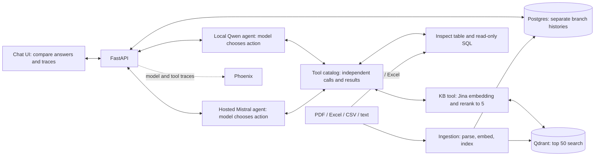
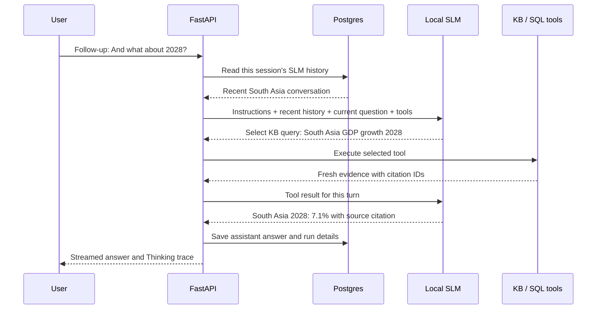

# Local SLM vs Hosted LLM — Client POC Brief

**Prepared: 5 November 2026 · Configuration verified from repository; live examples recorded on 2 November.**

This proof of concept compares a local small language model (SLM) with a hosted large language model (LLM), using the same knowledge base (KB).

## 1. Can a local SLM match an LLM on KB queries?

**A local SLM can give similar answers on specific, well-defined KB questions. This POC has not yet proved that it matches the LLM overall.** Retrieval-augmented generation (RAG) gives the model relevant source text to help answer document questions. This reduces reliance on what the model learned during training. [RAG research](https://arxiv.org/abs/2005.11401) explains the approach; it does not prove equal performance for our two models.

| Query type | Client interpretation |
| --- | --- |
| Facts, FAQs, document summaries | Good candidates for testing a local SLM. Answers need relevant sources and citations. |
| Excel/CSV filters and calculations | The model writes a SQL query; the SQL engine performs the calculation. Choosing the right tool also affects accuracy. |
| Unclear questions, multiple documents, long follow-ups | These need separate reliability tests. Equal performance cannot be assumed. |

**Observed examples:** local Qwen returned the South Asia 2028 forecast of **7.1%** and the India + South Asia 2027 average of **7.05%**, with source citations. Local runs with several model calls took about 45–113 seconds. These examples do not prove that local deployment is faster or cheaper at scale.

## 2. Configuration snapshot

| Component | POC configuration |
| --- | --- |
| Demo hardware | MacBook Air M5, 10 CPU cores, 24 GB unified memory; the local model runs in Docker using the CPU |
| Local SLM | [Qwen3-4B](https://huggingface.co/Qwen/Qwen3-4B), Q4_K_M GGUF format; served by llama.cpp; 16,384-token context; one request at a time |
| Hosted comparison | Mistral API; configured model `mistral-large-4`; account access needs verification |
| Retrieval | Jina `jina-embeddings-v5-text-small` creates 1,024-dimensional vectors; Qdrant searches for the top 50 matching passages |
| Reranking | Jina `jina-reranker-v3.5` selects the best 5 passages; Cohere is the fallback |
| Application and storage | FastAPI; lightweight HTML/CSS/JS + nginx; Postgres 16 for history, metadata and LLM cache; Python dependencies managed with `uv` |
| Agent limits | Up to 6 model calls and 8 source-tool calls per turn; output limits per call: SLM 512, hosted 1,024 tokens; temperature 0, top_p 1 |
| Logging | Phoenix records model names, session IDs, and model/tool inputs and outputs; the UI Thinking trace shows tool activity |

**Data boundary:** the SLM generates answers locally, but Jina/Cohere APIs and the hosted model are external services. The complete application is not fully offline. Configuration sources: [Compose](../compose.yaml), [settings](../backend/src/rag_api/settings.py).

## 3. Architecture and request flow

The model first chooses an action: reply directly or use a tool. After receiving tool results, it can answer or try another query within the configured limits. Both agents use the same KB, but keep separate chat histories and tool results. The confidence score estimates source support; it is not a probability that the answer is correct.

## 4. How does the SLM store context?

**The application manages conversation memory. Chatting does not retrain the model or change its weights.**

| Memory | Stored where? | Purpose |
| --- | --- | --- |
| Conversation history | Postgres + persistent Docker volume | User and assistant messages are saved by session and model branch. They survive restarts while the volume is retained. |
| Knowledge base | Qdrant vectors; source files and Postgres metadata | Provides relevant document evidence. It does not replace chat history. |
| Working context | Temporary model memory / KV cache | Holds instructions, recent messages, the question and tool results. The answer must also fit within the configured 16K-token limit. |

For each request, the application sends the branch's **last 6 previous messages**—usually 3 question-answer pairs—with up to **2,000 characters per previous message**. It adds the current question separately, removes old citation IDs, and adds fresh tool results during the turn. Older messages remain in the database but are not all sent to the model. Automatic summaries of older conversations are not implemented. [Context implementation](../backend/src/rag_api/runner.py).

The response cache reuses results for exactly matching model requests. It is separate from conversation memory and does not train the model. The hosted branch follows the same process using its own chat history.
